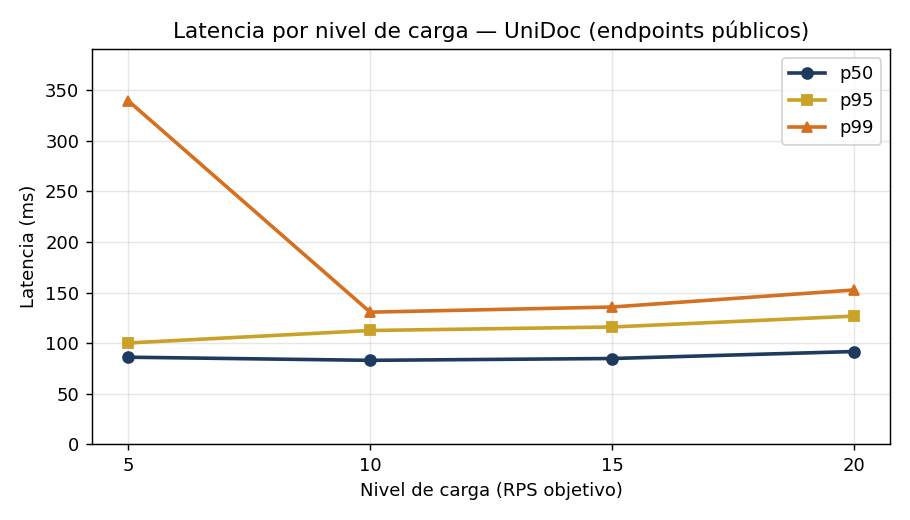
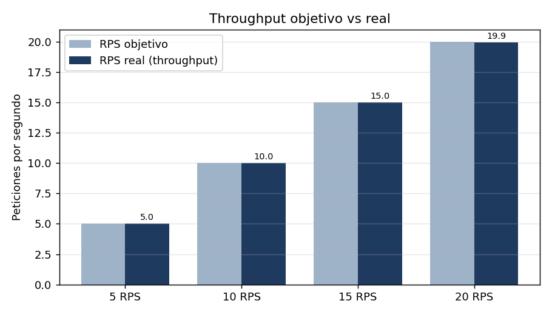

# INFORME DE PRUEBAS DE RENDIMIENTO (CARGA Y ESTRÉS)
## Plataforma NOVA — Módulo UniDoc · Rol **Rectoría**
### Calidad de Software II — Trabajo Final · Entregable 2 de 3

---

## 1. Portada y control de versiones

| Campo | Detalle |
|---|---|
| **Institución** | Corporación Universitaria Autónoma del Cauca (Uniautónoma) |
| **Asignatura** | Calidad de Software II · **Docente:** Jefferson Andrés Muñoz |
| **Firma QA (rol asumido)** | Grupo 1 — Aseguramiento de Calidad |
| **Sistema bajo prueba** | NOVA — `https://nova.uniautonoma.edu.co/` |
| **Aplicación / módulo** | UniDoc — Convocatorias y Gestión de Avales |
| **Rol evaluado** | **Rectoría** |
| **Fecha de entrega** | 17 de noviembre de 2026 |

**Integrantes:** Jaiver Muñoz Muñoz · Martha Isabel España Gonzales

**Historial de versiones**

| Versión | Fecha | Autor | Cambio |
|---|---|---|---|
| 1.0 | 16/11/2026 | Equipo G1 | Medición preliminar del servidor (módulo Tickets, herramienta Node). |
| 2.0 | 16/11/2026 | Equipo G1 | Corrección de alcance a UniDoc–Rectoría; plan JMeter/Vegeta. |
| 3.0 | 17/11/2026 | Equipo G1 | **Ejecución real con Vegeta** sobre endpoints públicos de UniDoc (4 niveles); resultados, gráficas y análisis. |

---

## 2. Resumen ejecutivo

Se ejecutaron pruebas de carga y estrés con **Vegeta** sobre los **endpoints públicos de entrada** del rol **Rectoría** en UniDoc (pantalla de acceso y portal de convocatorias), en 4 niveles ascendentes (5, 10, 15 y 20 peticiones por segundo).

**Conclusiones principales:**

- La capa de entrada de UniDoc **soportó los 4 niveles sin un solo error**: 1 000 peticiones en total, **100 % con código 200** y **0 % de fallos**.
- Los tiempos de respuesta se mantuvieron **bajos y estables**: p95 entre **100 y 127 ms** en todos los niveles, muy por debajo de los umbrales de aceptación.
- El **throughput real siguió al objetivo** con ≥ 99,6 % de ajuste en cada nivel.
- **No se alcanzó un punto de degradación ni de ruptura** dentro del tope prudente de 20 RPS. Esto es coherente: estos endpoints públicos son livianos frente a los endpoints autenticados con base de datos (ver referencia del Anexo A, que colapsó a 40 RPS).

**Recomendación general:** la capa de acceso del rol Rectoría es **robusta** para el uso esperado. Para dimensionar la capacidad de las **operaciones autenticadas de avales** (consultas con base de datos) se requiere una prueba con sesión de Rectoría dentro de una ventana autorizada.

---

## 3. Objetivos y alcance

**Objetivo.** Medir la capacidad de respuesta y buscar el punto de degradación de la capa de entrada de UniDoc que utiliza el rol Rectoría, frente a criterios de aceptación definidos de antemano.

**Incluido:** endpoints HTTP **públicos** de UniDoc:
- `GET /convocatorias-app/inicio-sesion` (pantalla de acceso de Rectoría).
- `GET /convocatorias-app` (portal de convocatorias).

**Excluido y por qué:**
- Las **APIs autenticadas de Rectoría** (`/convocatorias-app/api/rectoria/...`): requieren un token emitido tras el login con Google institucional, no disponible para generación de carga.
- Operaciones de **otorgar/revocar avales** bajo carga: prohibidas por no alterar datos reales.
- Pruebas por encima del tope prudente de 20 RPS fijado por el equipo (sección 6.1).

---

## 4. Sistema bajo prueba y escenarios

El sistema es el frontend/proxy de NOVA (Nginx) que sirve UniDoc. Los dos endpoints son **representativos del inicio de la jornada del rol Rectoría**: todo usuario de Rectoría carga primero la pantalla de acceso y el portal antes de autenticarse. Miden la capacidad del servidor web y la entrega del SPA, el primer punto que percibe el usuario.

---

## 5. Entorno de pruebas

| Elemento | Valor |
|---|---|
| Máquina cliente (generador de carga) | Equipo de escritorio del equipo G1 — Windows 11 (64 bits), CPU AMD Ryzen 5 9600X de 6 núcleos, 15 GB de RAM (valor informado por Windows) |
| Conectividad | Internet público hacia el dominio institucional (incluye salto WAN); el ancho de banda del enlace no se midió |
| Servidor bajo prueba | NOVA — Nginx (cabecera `Server: nginx`) como proxy inverso |
| Herramienta | **Vegeta** (línea de comandos) con salida JSON; artefactos `.bin` conservados |
| Fecha y hora de ejecución | 16/11/2026, 23:58:59 → 17/11/2026, 00:00:34 (America/Bogota) |

---

## 6. Criterios de aceptación

Definidos **antes** de ejecutar:

| Métrica | Umbral carga normal | Umbral estrés | Justificación |
|---|---|---|---|
| p95 de latencia | < 800 ms | < 3 000 ms | > 1 s se percibe lento; > 3 s provoca abandono |
| p50 (mediana) | < 400 ms | < 1 500 ms | Experiencia del 50 % de las solicitudes |
| Tasa de errores | 0,00 % | < 5,00 % | Sin errores en uso normal; tolerancia mínima en estrés |
| RPS real / objetivo | ≥ 95 % | ≥ 80 % | El servidor debe sostener el volumen inyectado |

### 6.1 Límites y ventana adoptados por el equipo
El docente **no fijó** ventana ni límite máximo de carga para este grupo. Por responsabilidad y para no afectar el servicio en producción, el equipo adoptó: **máximo 20 RPS**, escalones cortos de **20 s**, y **parada inmediata** si un nivel superaba 5 % de error o p95 > 3 s. Estos valores se mantienen por debajo del punto de colapso de la medición de referencia (Anexo A, 40 RPS → 504). La corrida se realizó cerca de medianoche (bajo uso).

---

## 7. Diseño de las pruebas

Prueba escalonada, **4 niveles ascendentes**, 20 s por nivel, con 5 s de estabilización entre niveles:

| Nivel | ID | Tipo | RPS objetivo | Duración |
|---|---|---|---|---|
| 1 | REC-PF-01 | Carga (línea base) | 5 | 20 s |
| 2 | REC-PF-02 | Carga esperada | 10 | 20 s |
| 3 | REC-PF-03 | Estrés moderado | 15 | 20 s |
| 4 | REC-PF-04 | Estrés | 20 | 20 s |

---

## 8. Ejecución

Se ejecutó con el script `EJECUTAR_RENDIMIENTO.bat`, que por cada nivel lanza `vegeta attack` (con `-targets=rendimiento/targets_unidoc.txt -rate=<n>/s -duration=20s`) y guarda el binario de resultados; los reportes JSON se obtuvieron de esos binarios con `vegeta report -type=json`. No se registraron incidentes de red durante la corrida. Las 1 000 peticiones se completaron según lo planificado.

---

## 9. Resultados

### 9.1 Tabla consolidada por nivel

| Métrica | REC-PF-01 (5 RPS) | REC-PF-02 (10 RPS) | REC-PF-03 (15 RPS) | REC-PF-04 (20 RPS) |
|---|---|---|---|---|
| Peticiones totales | 100 | 200 | 300 | 400 |
| Exitosas (200 OK) | 100 (100 %) | 200 (100 %) | 300 (100 %) | 400 (100 %) |
| Latencia mínima | 38 ms | 37 ms | 41 ms | 47 ms |
| Latencia media | 77 ms | 78 ms | 78 ms | 86 ms |
| **p50 (mediana)** | **86 ms** | **83 ms** | **85 ms** | **92 ms** |
| **p95** | **100 ms** | **112 ms** | **116 ms** | **127 ms** |
| **p99** | **340 ms** | **131 ms** | **136 ms** | **153 ms** |
| Latencia máxima | 410 ms | 146 ms | 142 ms | 191 ms |
| Throughput real | 5,03 RPS | 10,00 RPS | 14,98 RPS | 19,93 RPS |
| Tasa de errores | 0,00 % | 0,00 % | 0,00 % | 0,00 % |
| Códigos HTTP | 200×100 | 200×200 | 200×300 | 200×400 |

### 9.2 Gráficas

{width=85%}

{width=85%}

Fuente: `rendimiento/resultados/nivel_{5,10,15,20}.json` (salida de Vegeta).

---

## 10. Análisis de resultados

### 10.1 Cumplimiento frente a los criterios de aceptación

| Nivel | p95 real vs criterio | Error vs criterio | RPS real/objetivo | Estado |
|---|---|---|---|---|
| 1 (5 RPS) | 100 ms (< 800) | 0 % (= 0 %) | 100,6 % | **CUMPLE** |
| 2 (10 RPS) | 112 ms (< 800) | 0 % (= 0 %) | 100,0 % | **CUMPLE** |
| 3 (15 RPS) | 116 ms (< 3 000) | 0 % (< 5 %) | 99,9 % | **CUMPLE** |
| 4 (20 RPS) | 127 ms (< 3 000) | 0 % (< 5 %) | 99,6 % | **CUMPLE** |

### 10.2 Lectura técnica

- **Estabilidad.** La latencia media y la mediana apenas se mueven entre 5 y 20 RPS (p50 de 83–92 ms), y el p95 sube de forma muy suave (100 → 127 ms). No hay señales de encolamiento ni de saturación en este rango.
- **Punto de degradación / ruptura.** **No se alcanzó** dentro del tope prudente de 20 RPS; la capa pública de UniDoc tiene capacidad por encima de ese nivel. Determinar el punto exacto exigiría subir la carga, lo que no se hizo por no contar con ventana autorizada.
- **Outlier del p99 en el Nivel 1.** El p99 del primer nivel (340 ms, máx. 410 ms) es mayor que en los niveles siguientes (~130–150 ms). Es un efecto de **arranque en frío** (primeras conexiones TLS/keep-alive del inicio de la corrida), no de carga: el mínimo fue 38 ms y la media 77 ms. A partir del Nivel 2, con las conexiones ya establecidas, la cola alta de latencias baja.
- **Comparación con la referencia (Anexo A).** La medición previa sobre los endpoints **autenticados** del módulo Tickets colapsó a 40 RPS (81 % de 504). La diferencia es esperable: aquí se probó la **capa pública liviana** y hasta 20 RPS; aquellos endpoints ejecutan lógica y consultas a base de datos. Por tanto, **la capacidad de las operaciones autenticadas de avales sigue sin medirse**.

---

## 11. Conclusiones y recomendaciones

### 11.1 Conclusiones
1. La capa de acceso pública de UniDoc **cumple todos los criterios** de aceptación en los 4 niveles, con 0 % de errores y p95 ≤ 127 ms.
2. **Capacidad estimada:** sostiene al menos **20 RPS** con holgura en los endpoints de entrada; el punto de ruptura de esa capa está por encima de 20 RPS y no se determinó.
3. La prueba **no cubre** el rendimiento de las operaciones autenticadas de avales, que es donde el servidor compartido mostró límites en la referencia.

### 11.2 Recomendaciones
1. Para dimensionar las operaciones de avales, ejecutar una prueba con **sesión de Rectoría** (token válido) sobre sus APIs, dentro de una **ventana autorizada por el docente/administrador**.
2. Mantener la medición de la capa pública como **línea base** para detectar regresiones.
3. Si se planean eventos de alta concurrencia, aplicar las mejoras de la referencia (workers del backend, *pooling* de base de datos, caché de catálogos).

---

## 12. Riesgos y limitaciones

1. **Servidor compartido:** UniDoc, Tickets y Planes de Aula comparten infraestructura; un pico en otro módulo afecta a Rectoría.
2. **Cliente/red:** la latencia incluye el salto WAN; parte del retardo es de red, no del servidor.
3. **Alcance de medición:** solo endpoints públicos; las APIs autenticadas de avales quedan sin medir por no disponer de sesión de Rectoría automatizable para carga.
4. **Tope prudente:** al no haber ventana autorizada, se limitó a 20 RPS; por eso no se observó el punto de ruptura de la capa pública.

---

## 13. Anexos

### Anexo A — Medición de referencia del servidor (módulo Tickets, herramienta Node) — NO es resultado de Rectoría

Medición real previa sobre endpoints del módulo **Tickets** con un motor de carga en Node. Se incluye **solo como referencia** del techo del servidor compartido. Datos crudos en `_descartado/recon_tickets/benchmark_results.json`.

| Nivel | RPS obj. | Peticiones | p50 | p95 | p99 | Throughput real | Errores | Códigos |
|---|---|---|---|---|---|---|---|---|
| 1 | 5 | 75 | 147 ms | 181 ms | 193 ms | 5,01 RPS | 0 % | 200×75 |
| 2 | 12 | 180 | 163 ms | 219 ms | 235 ms | 11,92 RPS | 0 % | 200×180 |
| 3 | 25 | 375 | 6 491 ms | 9 243 ms | 9 406 ms | 17,64 RPS | 0 % | 200×375 |
| 4 | 40 | 600 | 10 045 ms | 10 058 ms | 10 063 ms | 23,97 RPS | **81,33 %** | 200×112 / **504×488** |

Lectura: los endpoints autenticados se degradan hacia 25 RPS y colapsan a 40 RPS. Contrasta con la capa pública probada en este informe, estable hasta 20 RPS.

### Anexo B — Artefactos
- `Plan_Rendimiento_Nova.jmx` (JMeter, endpoints públicos de UniDoc, parametrizable).
- `rendimiento/targets_unidoc.txt`, `rendimiento/run_vegeta.*`, `EJECUTAR_RENDIMIENTO.bat`, `GENERAR_JSON.bat`.
- Resultados: `rendimiento/resultados/nivel_{5,10,15,20}.json` y `.bin`.
- Gráficas: `rendimiento/graficas/latencias.png`, `throughput.png`.
